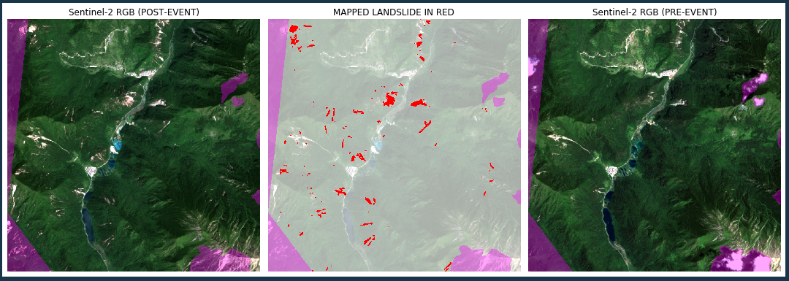
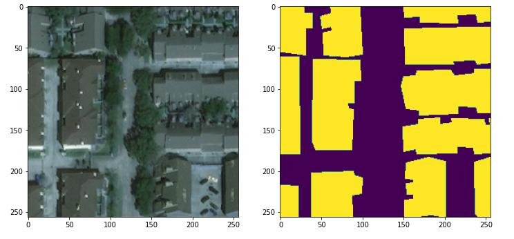
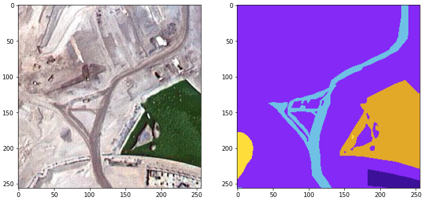
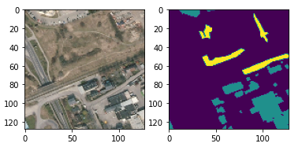

# Deep learning for satellite imagery

Practical, notebook-based examples of using deep learning to turn satellite and aerial imagery into maps. The repository covers three remote-sensing tasks: building-footprint segmentation, land-use/land-cover (LULC) classification, and event-driven landslide mapping.

> **Notebook-first project.** Run notebooks from their own directories so that their relative data paths resolve correctly. The example data and model artifacts are intended for learning and experimentation—not as validated operational products.

<p align="center">
  
</p>

## What is included

| Workflow | Goal | Data / inputs | Main notebook |
| --- | --- | --- | --- |
| Building detection | Segment building footprints in post-disaster imagery | xView2-style RGB images and binary target masks | [`Building detection/Building detection.ipynb`](Building%20detection/Building%20detection.ipynb) |
| LULC classification | Predict per-pixel land-cover classes | Preprocessed NumPy arrays or tiled aerial images and colour masks | [`LULC classification/01. numpy dataset/Land cover mapping.ipynb`](LULC%20classification/01.%20numpy%20dataset/Land%20cover%20mapping.ipynb) |
| Landslide mapping | Map likely landslide areas from multi-source geospatial imagery | Pre/post Sentinel-2 RGB, DEM-derived hillshade and slope, plus an area mask | [`Landslide mapping/LS_mapping.ipynb`](Landslide%20mapping/LS_mapping.ipynb) |

## Gallery

<p align="center">
  
  
  
</p>

## Getting started

The notebooks were authored with Python 3.9. Create an isolated environment, install the shared dependencies, then add the workflow-specific extras you need.

```bash
git clone https://github.com/iamtekson/Deep-learning-for-satellite-imagery.git
cd Deep-learning-for-satellite-imagery

python -m venv .venv
source .venv/bin/activate  # Windows: .venv\Scripts\activate
python -m pip install --upgrade pip
pip install jupyter tensorflow numpy matplotlib opencv-python pillow patchify tqdm scikit-learn
```

For the ResNet-backed LULC experiment, also install:

```bash
pip install segmentation-models
```

The landslide workflow additionally requires GDAL and its Python bindings, which are best installed through your operating system or Conda distribution so that the native GDAL library and Python package versions match. It also uses `opencv-python`, TensorFlow, NumPy, Matplotlib, and `tqdm` from the shared setup.

Launch a notebook from the directory that contains it:

```bash
cd "Building detection"
jupyter notebook "Building detection.ipynb"
```

## Workflows

### Building detection

This notebook trains a binary U-Net on 256 × 256 patches cut from 1024 × 1024 RGB images. It filters out all-background mask patches, creates an 80/20 train-test split, and writes the best checkpoint to `model_output.h5`.

The included example is structured like the [xView2](https://xview2.org/) disaster-assessment dataset, using images in `data/images/` and masks in `data/targets/`. The notebook defaults to 2,000 source images; adjust `NUMBER_OF_IMAGES` to match the data available locally.


### Land-use / land-cover classification

Two complementary U-Net workflows are provided.

- **Preprocessed NumPy dataset** — [`Land cover mapping.ipynb`](LULC%20classification/01.%20numpy%20dataset/Land%20cover%20mapping.ipynb) loads the included train/test arrays, trains a four-class U-Net, and predicts background, building, vegetation/forest, and water pixels.
- **Kaggle aerial-imagery dataset** — [`LULC (part I).ipynb`](LULC%20classification/02.%20kaggle%20dataset/LULC%20%28part%20I%29.ipynb) tiles imagery into 256 × 256 patches and trains a six-class semantic-segmentation model. [`LULC (part II).ipynb`](LULC%20classification/02.%20kaggle%20dataset/LULC%20%28part%20II%29.ipynb) explores a U-Net with a ResNet-34 encoder pretrained on ImageNet.

The aerial-imagery workflow is based on Kaggle's [Semantic Segmentation of Aerial Imagery](https://www.kaggle.com/datasets/humansintheloop/semantic-segmentation-of-aerial-imagery) dataset. Its classes are building, unpaved land, road, vegetation, water, and unlabeled.


### Landslide mapping

The landslide notebook combines pre- and post-event Sentinel-2 RGB imagery with DEM, hillshade, and slope layers. It resamples each layer to the study area, builds valid overlapping tiles, invokes a trained model, and exports confidence and thresholded GeoTIFF outputs to `Mapping_results/`.

The included data live under `Landslide mapping/RawData/AOI_E_S2-S2/`. Before running the notebook, download the pretrained `M_ALL_006.hdf5` model from the [project link](https://github.com/nprksh/landslide-mapping-with-cnn/raw/main/M_ALL_006.hdf5) and place it in `Landslide mapping/` beside `LS_mapping.ipynb`.

This implementation accompanies the paper [*Rapid mapping of landslides using a deep learning approach*](https://www.nature.com/articles/s41598-021-89015-8).


## Repository layout

```text
.
├── Building detection/
│   ├── Building detection.ipynb       # Binary U-Net workflow
│   └── data/                          # Example images and binary masks
├── LULC classification/
│   ├── 01. numpy dataset/             # Four-class, array-based workflow
│   └── 02. kaggle dataset/            # Six-class tiled-image workflow
├── Landslide mapping/
│   ├── LS_mapping.ipynb               # Geospatial inference workflow
│   ├── RawData/                       # Sentinel-2 and terrain inputs
│   └── Utils/                         # GDAL I/O and tiling helpers
└── assets/img/                        # README figures
```

## Notes

- The project ignores downloaded `.hdf5` models, notebook checkpoints, logs, and generated landslide maps. Keep a local copy of models you train or download, and review the ignore rules before committing other model formats.
- The building and LULC notebooks are training examples; their hyperparameters, train/test splits, and metrics should be revisited before applying them to a new region or sensor.
- Geospatial outputs retain the reference system of the supplied rasters when written by the landslide utilities.

## Citation and acknowledgement

If you use the landslide workflow in academic work, please cite the [associated Scientific Reports paper](https://www.nature.com/articles/s41598-021-89015-8) and acknowledge the original model and data sources. Please also follow the licensing and attribution requirements of [xView2](https://xview2.org/) and the [Kaggle dataset](https://www.kaggle.com/datasets/humansintheloop/semantic-segmentation-of-aerial-imagery).

## Contributing

Contributions that improve reproducibility, documentation, data preparation, or model evaluation are welcome. Please open an issue or pull request with a clear description of the change and any required data or environment details.
